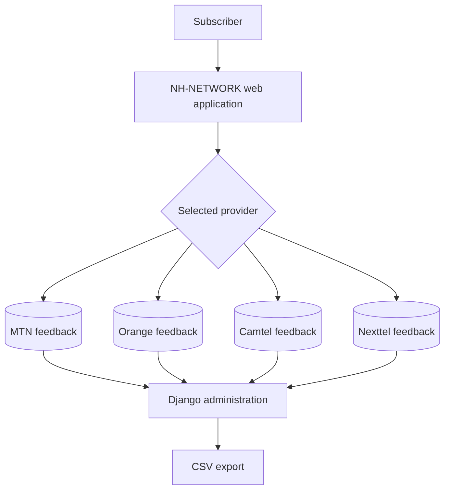

<!--
  NH-NETWORK README refresh.
  Documentation-only change: this update modifies README.md and no application code.
-->

<div align="center">

  

  <p><strong>A mobile network experience feedback platform concept for Cameroon.</strong></p>
  <p>📶 Network feedback · 📍 Location-aware reports · 📊 Provider insights</p>

  <p>
    <a href="https://nh-network.onrender.com/"></a>
    <a href="https://github.com/dieudonne670/nh-network"></a>
  </p>

  <p>
    
    
    
    
    
    
  </p>

  <p><em>Turning everyday mobile network experiences into structured feedback.</em></p>

</div>

---

## 🌍 Overview

**NH-NETWORK** is a Django-based web application concept for collecting mobile network experience reports from users in Cameroon.

The project is organized around four mobile network providers:

- MTN
- Orange
- Camtel
- Nexttel

Users can submit feedback associated with a provider, including a comment, rating, measured speed and optional geographic coordinates. The Django application stores provider-specific feedback records and exposes pages and JSON endpoints for submitting and reviewing this information.

The broader idea is to make user-reported network experiences easier to organize and analyze, helping identify where subscribers experience poor connectivity.

**Hosted demo:** [nh-network.onrender.com](https://nh-network.onrender.com/)

> **Project status:** This repository is an academic/portfolio project and prototype. The hosted demo is provided for exploration. Provider API forwarding, production security, database configuration and some analytics paths require further validation before the system should be treated as a production service or an official telecom/regulatory integration.

## ✨ Current project capabilities

| Area | What the repository contains |
| --- | --- |
| Provider-specific feedback | Separate Django models for MTN, Orange, Camtel and Nexttel |
| Feedback data | Name, email, comment, submission date, rating, speed and optional coordinates |
| User accounts | Django authentication-based signup and login views |
| Provider pages | Dedicated pages and form handlers for the four providers |
| JSON submission routes | Provider-specific POST endpoints |
| CSV exports | Provider-specific CSV export views |
| Django administration | Registered provider feedback models and CSV admin actions |
| Hosted demo | A Render deployment link documented by the project |

The repository also contains an early provider-forwarding workflow. Its destination URLs and credentials are placeholders and must not be considered verified integrations with the telecom operators.

## 🧭 How the application is organized

At a high level, the intended user journey is:

1. A subscriber opens the web application.
2. The subscriber chooses a mobile network provider.
3. The subscriber submits feedback about their experience.
4. The Django application stores the report in the corresponding provider model.
5. Authorized project administrators can review stored records and export data for analysis.



This is a conceptual view of the repository's provider-specific data model and export workflow, not a claim that telecom operators receive the reports automatically.

## 🧰 Technology stack

| Layer | Technology | Role |
| --- | --- | --- |
| Language | Python | Application logic |
| Backend framework | Django 5.2.4 | Pages, authentication, models and request handling |
| API-related dependency | Django REST Framework 3.16.1 | Included in the project dependencies |
| Database in checked-in settings | SQLite | Current default local database configuration |
| Frontend | HTML, CSS, JavaScript | Web interface and feedback forms |
| HTTP client | Requests | Outbound HTTP integration code |
| Static assets | WhiteNoise | Static-file serving configuration |
| Scheduled-task dependency | django-crontab | Scheduled task configuration |
| Application server | Gunicorn | Documented Render deployment command |
| Hosting | Render | Hosted demo |

## 🗂️ Project structure

The repository includes the following main components:

```text
NH-NETWORK/
├── feedback/
│   ├── templates/
│   │   └── feedback/
│   ├── static/
│   ├── models.py
│   ├── views.py
│   ├── api_views.py
│   ├── admin_views.py
│   ├── admin.py
│   ├── urls.py
│   ├── utils.py
│   └── cron.py
├── nhnetwork/
│   ├── settings.py
│   ├── urls.py
│   └── wsgi.py
├── requirements.txt
├── manage.py
└── README.md
```

## 📡 HTTP endpoints

The following provider-specific submission routes are defined in `feedback/urls.py`.

### Submit feedback

| Provider | Method | Route |
| --- | --- | --- |
| MTN | POST | `/api/mtn/feedback/` |
| Orange | POST | `/api/orange/feedback/` |
| Camtel | POST | `/api/camtel/feedback/` |
| Nexttel | POST | `/api/nexttel/feedback/` |

The JSON handlers accept fields corresponding to the provider feedback models:

```json
{
  "name": "Example Subscriber",
  "email": "subscriber@example.com",
  "comment": "Experiencing slow mobile data around Buea.",
  "latitude": 4.156,
  "longitude": 9.231,
  "speed": 2.5,
  "rating": 3
}
```

Use fictional test information when experimenting. Do not submit another person's personal information without permission.

### Export feedback as CSV

| Provider | Method | Route |
| --- | --- | --- |
| MTN | GET | `/api/export/mtn/` |
| Orange | GET | `/api/export/orange/` |
| Camtel | GET | `/api/export/camtel/` |
| Nexttel | GET | `/api/export/nexttel/` |

> **Access-control warning:** The current CSV export views do not show an authorization check in the inspected implementation. Restrict these routes to authorized staff before using real subscriber data or exposing them publicly.

## 📊 Data model

The project defines an abstract `BaseFeedback` model with shared fields:

- `name`
- `email`
- `comment`
- `date_submitted`

Four provider-specific models inherit these fields:

- `MTNFeedback`
- `OrangeFeedback`
- `CamtelFeedback`
- `NexttelFeedback`

Each provider model adds:

- `latitude` and `longitude` (optional)
- `speed` (optional, represented in Mbps in the model comments)
- `rating`

This design keeps provider feedback in separate tables while sharing the common subscriber-report fields.

## 🖼️ Interface previews

The following screenshots were already included in the repository's project documentation.

### Main application

<p align="center">
  
</p>

### Feedback analytics preview

<p align="center">
  
</p>

<p align="center">
  
</p>

## ⚙️ Run locally

### Prerequisites

- Python 3.10 or newer (the checked-in dependencies pin Django 5.2.4)
- pip
- Git

The checked-in Django settings currently use SQLite, so a separate database server is not required for the default local setup.

### 1. Clone the repository

```bash
git clone https://github.com/dieudonne670/nh-network.git
cd nh-network
```

### 2. Create and activate a virtual environment

Linux / macOS:

```bash
python3 -m venv env
source env/bin/activate
```

Windows PowerShell:

```powershell
python -m venv env
env\Scripts\Activate.ps1
```

### 3. Install dependencies

```bash
pip install -r requirements.txt
```

### 4. Apply database migrations

```bash
python manage.py migrate
```

### 5. Create an administrator account

```bash
python manage.py createsuperuser
```

### 6. Start the development server

```bash
python manage.py runserver
```

Open [http://127.0.0.1:8000/](http://127.0.0.1:8000/) in your browser.

The Django administration interface is available at [http://127.0.0.1:8000/admin/](http://127.0.0.1:8000/admin/).

## ☁️ Deployment notes

The repository README documents a Render deployment using Gunicorn and WhiteNoise. The checked-in `requirements.txt` includes both dependencies.

Before deploying or redeploying, review the current Render service configuration and configure production settings safely. The checked-in `nhnetwork/settings.py` currently contains development-oriented settings and should not be copied unchanged into a public production environment.

A production deployment should, at minimum:

- Load `SECRET_KEY` from a secure environment variable.
- Set `DEBUG=False`.
- Set `ALLOWED_HOSTS` to the actual application hostnames.
- Configure CSRF trusted origins where required.
- Use a persistent production database and verify migrations.
- Protect admin and data-export endpoints.
- Configure static-file collection and verify the deployed static assets.
- Review scheduled-task configuration and outbound integrations before enabling them.

The repository's current default database configuration is SQLite. PostgreSQL support should only be advertised as an active deployment feature after the production database configuration is verified.

## 🔒 Security and privacy

Network feedback can include personal information and location data. A real deployment must protect both.

**Important items to address before production use:**

1. **Secret management:** A Django secret key is currently hardcoded in the tracked settings file. Treat it as exposed if it has ever been used in a deployed environment. Rotate it and load the replacement from an environment variable.
2. **Debug mode:** The checked-in settings set `DEBUG=True`. Production must use `DEBUG=False`.
3. **Allowed hosts:** The checked-in settings use a wildcard host configuration. Restrict this to the actual deployment domains.
4. **CSV exports:** Add authentication and staff-level authorization before exposing subscriber exports.
5. **Feedback endpoints:** Validate request payloads, handle malformed JSON, apply rate limits and use appropriate CSRF/authentication protections.
6. **Provider integrations:** Replace placeholder tokens and unverified destination URLs with credentials and endpoints supplied through official operator integration agreements. Never commit real tokens.
7. **Personal data:** Collect only what is needed, explain how it will be used, and define retention and deletion procedures.

The project is a prototype and should not be used to collect sensitive real-world subscriber information until these controls have been implemented and tested.

## 🧪 Validation checklist

Before presenting a new release as production-ready, validate the following:

- [ ] All four provider forms submit successfully.
- [ ] Each provider's POST endpoint stores a valid record.
- [ ] Invalid JSON and invalid field values return safe error responses.
- [ ] Signup, login, logout and protected pages behave as expected.
- [ ] Analytics pages use the correct model fields and render without errors.
- [ ] CSV exports return the intended provider records and require staff authorization.
- [ ] Scheduled tasks run only when configured and use verified destinations.
- [ ] Production secrets are rotated and loaded from environment variables.
- [ ] Production debug mode is disabled and allowed hosts are restricted.
- [ ] Database persistence and backups are verified.

## 🛣️ Roadmap

Potential next steps for the project:

- [ ] Refactor repeated provider submission logic into reusable, validated Django forms or serializers.
- [ ] Add automated tests for models, views, authentication and API endpoints.
- [ ] Add staff-only permissions to analytics and CSV exports.
- [ ] Move all secrets and environment-specific settings out of source control.
- [ ] Validate and harden location collection and subscriber privacy.
- [ ] Replace placeholder provider forwarding with verified integrations, if official access is granted.
- [ ] Add a reliable production database configuration and backup strategy.
- [ ] Improve analytics with tested provider and geographic summaries.
- [ ] Explore a mobile client after the backend workflows are stable.
- [ ] Evaluate network-quality trend analysis using validated, consented data.

## 🎓 What this project demonstrates

NH-NETWORK is a practical project exploring:

- Python and Django application development.
- Relational data modelling with Django ORM.
- Provider-specific data organization.
- Form handling and JSON HTTP endpoints.
- User authentication and Django administration.
- CSV data export.
- Linux-based development and cloud deployment.
- The engineering challenges of handling location and subscriber feedback responsibly.

## 👨‍💻 Author

**Kindong Dieudonne**  
Software Engineering graduate · Python Backend Developer

- GitHub: [@dieudonne670](https://github.com/dieudonne670)
- LinkedIn: [Kindong Dieudonne](https://www.linkedin.com/in/kindong-dieudonne-826ba9328/)

---

<div align="center">

  <p><strong>Better network experiences start with better feedback.</strong></p>
  <p><sub>NH-NETWORK — an independent project exploring mobile network experience reporting in Cameroon.</sub></p>

</div>
